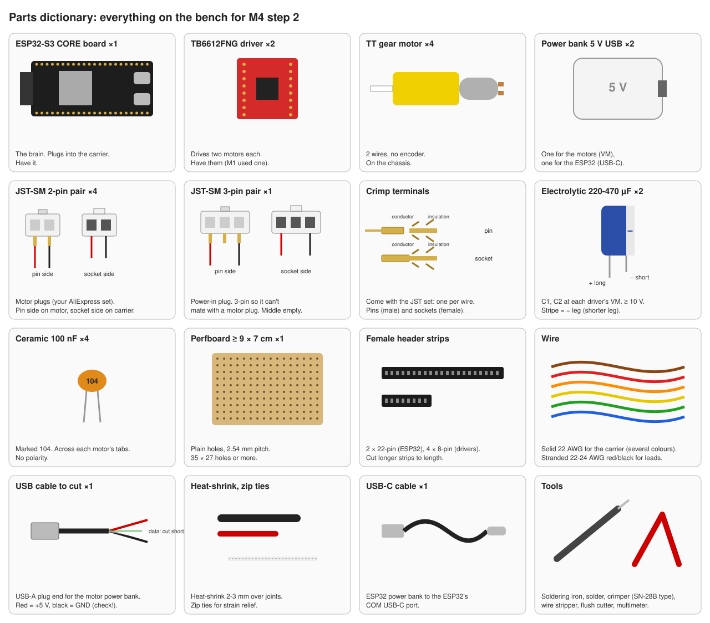
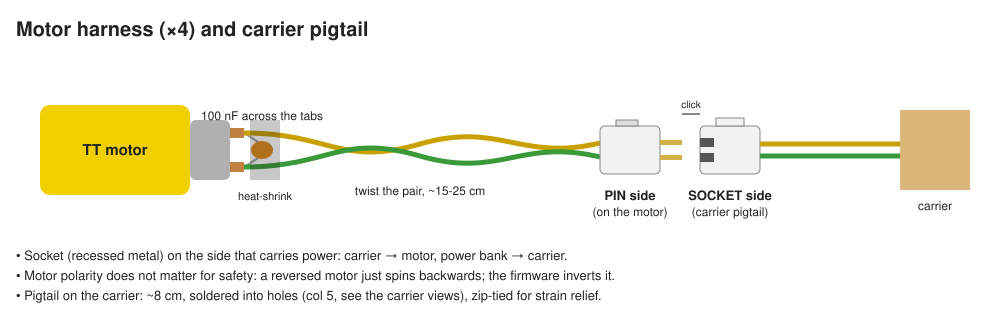
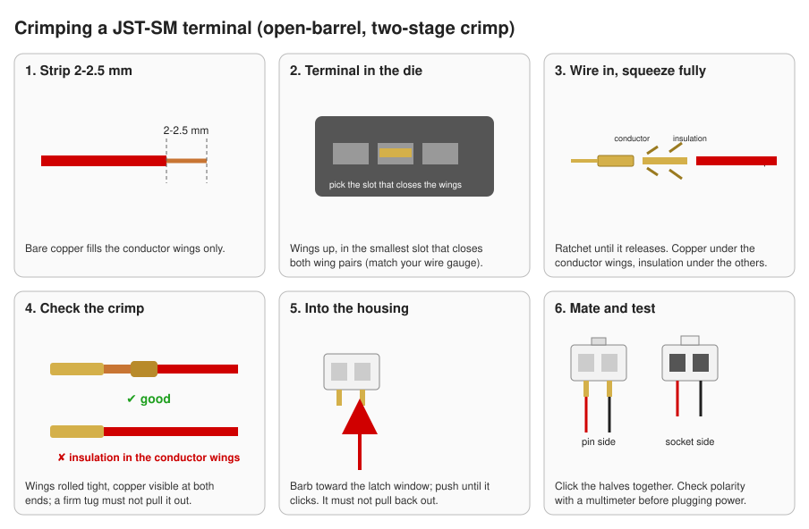
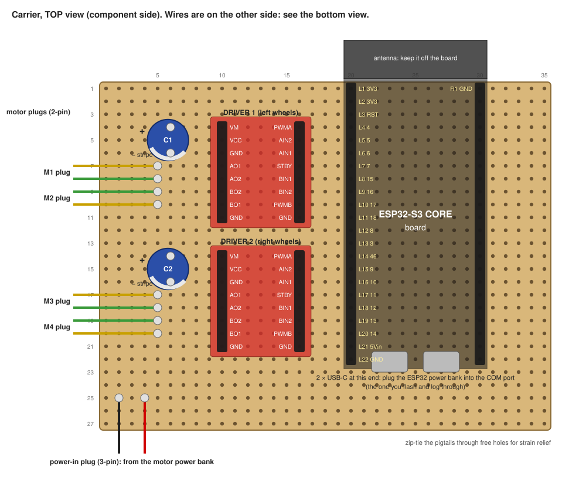
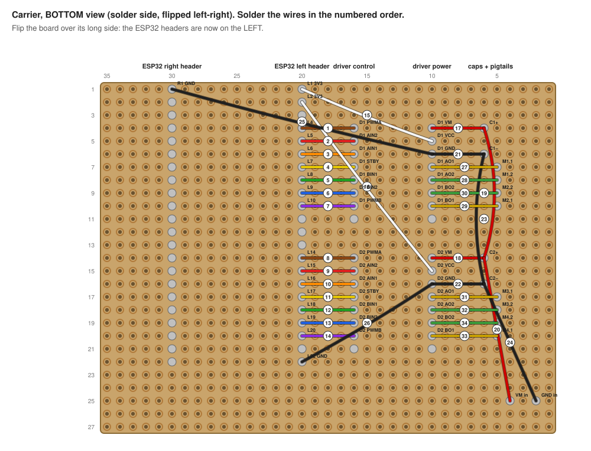

# Build guide: the M4 four-motor carrier

This guide takes you from loose parts to a soldered **carrier board** that holds the ESP32 and both motor drivers, with latching plugs for the four motors and the motor power bank. It replaces the breadboard and Dupont jumpers.

The circuit is the one in [`../wiring.kicad_sch`](../wiring.kicad_sch) and [`../WIRING.md`](../WIRING.md). The perfboard layout and the numbered wire list are generated by [`gen_build_guide.py`](gen_build_guide.py). Its `--check` traces every wire on the board and proves the board connects exactly what the schematic says: 25 nets, 34 wires, 0 problems.

**Time:** an evening. **Skills:** through-hole soldering, crimping.

## Contents

1. [Parts dictionary](#1-parts-dictionary)
2. [Tools](#2-tools)
3. [Motor harnesses](#3-motor-harnesses-4)
4. [Motor power cable](#4-motor-power-cable)
5. [The carrier board](#5-the-carrier-board)
6. [Checks before power](#6-checks-before-power)
7. [First power-up](#7-first-power-up)
8. [Videos and references](#8-videos-and-references)

## 1. Parts dictionary

| Part | Qty | For | Notes |
| --- | --- | --- | --- |
| ESP32-S3-N16R8 CORE board | 1 | controller | [pinout](../../../docs/reference/esp32-s3-n16r8/pinout.png) |
| TB6612FNG driver module | 2 | motor drivers | [pinout](../../../docs/reference/tb6612fng/pinout.jpg); each already carries a 10 µF capacitor on VM |
| TT gear motor | 4 | wheels | 2 wires, no encoder |
| 5 V USB power bank | 2 | one for the motors, one for the ESP32 | |
| JST-SM 2-pin pair (pin + socket housing) | 4 | motor plugs | your AliExpress set |
| JST-SM 3-pin pair | 1 | motor power input | 3-pin so it can't mate with a motor plug; middle position empty |
| JST-SM crimp terminals | about 20 | one per wire end | pins and sockets come in the set |
| Electrolytic capacitor 220-470 µF, ≥ 10 V | 2 | C1, C2 at each driver's VM | stripe = − |
| Ceramic capacitor 100 nF (marked `104`) | 4 | across each motor's tabs | no polarity |
| Perfboard, plain holes, 2.54 mm | 1 | the carrier | at least 35 × 27 holes (about 9 × 7 cm) |
| Female header strip | 2 × 22-pin, 4 × 8-pin | sockets for the ESP32 and the drivers | cut from longer strips |
| Solid hookup wire, 22 AWG, several colours | about 2 m | carrier wiring | colours as in the wire list |
| Stranded wire, 22-24 AWG, two colours | about 2 m | motor leads, pigtails | |
| USB-A cable you can cut | 1 | motor power cable | |
| USB-C cable | 1 | ESP32 power bank to the ESP32 | |
| Heat-shrink 2-3 mm, zip ties | some | insulation, strain relief | |

## 2. Tools

Soldering iron and solder, an open-barrel crimper (SN-28B type), a wire stripper, flush cutters, a multimeter, a heat gun or lighter for the heat-shrink, and tape or Blu-Tack to hold parts while soldering.

## 3. Motor harnesses (×4)

For each motor:

1. Cut two stranded wires, 15-25 cm, one in each colour (yellow = lead 1, green = lead 2 in the drawings).
2. Solder one wire to each motor tab. Solder the **100 nF ceramic capacitor across the two tabs**, with legs short, as close to the motor as possible.
3. Slide heat-shrink over the joints and shrink it. Twist the two wires around each other; this reduces electrical noise.
4. Crimp a **pin terminal** on each wire end (see [crimping](#crimping)), then push them into a 2-pin **pin-side** housing. Put lead 1 in the same position on all four motors.
5. Label the motor: FL, RL, FR, RR (front/rear, left/right).

Make the **carrier pigtails** the same way, about 8 cm long: **socket terminals** in a **socket-side** housing on one end, bare tinned ends on the other (they get soldered into the carrier).

**Why sockets on the carrier:** the side that carries power gets the recessed metal, so an unplugged live plug can't short against anything. Motor polarity doesn't matter for safety: a reversed motor just spins backwards, and the firmware's per-motor `invert` setting fixes it.

### Crimping

1. Strip 2-2.5 mm: only bare copper goes into the front wings (conductor), insulation into the rear wings.
2. Put the terminal in the smallest die slot that closes both wing pairs, wings facing up.
3. Insert the wire and squeeze until the ratchet releases.
4. Check the crimp: wings rolled tight, no insulation under the conductor wings, a firm tug doesn't pull it out. Redo any doubtful one; it's cheap.
5. Push it into the housing with the barb (lance) facing the latch window until it clicks. It must not pull back out.

The [Core Electronics crimping guide](https://core-electronics.com.au/guides/prototyping/how-to-crimp-custom-connectors/) shows this with photos and video. The [SN-28B video](https://vimeo.com/449552756) shows the same tool type.

## 4. Motor power cable

1. Cut the USB-A cable about 30 cm from the USB-A plug. Strip the outer jacket 4 cm.
2. **Find +5 V and GND with the multimeter:** plug the USB-A end into the motor power bank, switch it on, and measure between the wires. Usually red = +5 V and black = GND; verify, don't assume. Unplug it again.
3. Cut the data wires (green, white) short and insulate each one separately with heat-shrink.
4. Crimp **socket terminals** on red and black and put them in a 3-pin **socket-side** housing: **red in position 1, black in position 3, position 2 empty**. Mark position 1 with a red dot.
5. Make the carrier's **power-in pigtail** the same way with **pin terminals** in a 3-pin **pin-side** housing: red in 1, black in 3.

Because the housing is keyed, the plug only fits one way round, and its 3 pins can't mate with a 2-pin motor plug.

## 5. The carrier board

Two views of the same board. The **top view** shows where parts sit. The **bottom view** is the solder side, flipped left to right, because that's what you see when you turn the board over to solder.

Holes are numbered (column, row) on the top view: columns 1-35 left to right, rows 1-27 top to bottom, with the ESP32 antenna end at the top.

### 5.1 Dry fit (no solder yet)

1. Plug the female header strips onto the ESP32 and the two driver modules.
2. Lay them on the perfboard:
   - **ESP32:** left header in column 20, right header in column 30, from row 1 (3V3, antenna end) to row 22. The two headers are **10 holes apart**.
   - **Driver 1:** power header (VM…GND) in column 10, control header (PWMA…GND) in column 16, rows 4-11. The headers are **6 holes apart**.
   - **Driver 2:** same columns, rows 14-21.
3. Check that the antenna sticks out past the top edge (no copper under it is best), and that both USB-C ports at the bottom end are reachable.
4. If your boards' header spacing differs from 10 and 6 holes, **stop** and tell me; the layout and the check are regenerated from one table.

### 5.2 Solder the header sockets

Solder each strip **with its board plugged in**, so the sockets stay aligned. Tack one pin at each end, check the strip sits flat, then solder the rest. Then remove the boards: they stay out until step 7.

### 5.3 Capacitors

- **C1:** + leg in hole (6, 4), − leg (striped side) in (6, 6).
- **C2:** + leg in (6, 14), − leg in (6, 16).

The long leg is +. **Double-check the stripe faces the GND hole**: a reversed electrolytic can burst.

### 5.4 Pigtails

Push the motor pigtails' bare ends through from the top and solder them:

| Pigtail | Lead 1 (yellow) | Lead 2 (green) |
| --- | --- | --- |
| M1 front-left | (5, 7) | (5, 8) |
| M2 rear-left | (5, 10) | (5, 9) |
| M3 front-right | (5, 17) | (5, 18) |
| M4 rear-right | (5, 20) | (5, 19) |

Then the power-in pigtail: red (VM) at (4, 25) and black (GND) at (2, 25). Zip-tie each pigtail through two free holes, so a tug on the plug pulls on the tie, not the joint.

### 5.5 The wires

Solder the 34 wires in the order of [**the wire list**](wire-list.md). The numbers match the bottom view.

- **Wires 1-14** (the two "ribbons") are short straight hops along a row, from the driver control pin to the ESP32 pin.
- **Wires 15-26** are power: white = 3V3, red = VM, black = GND.
- **Wires 27-34** run from the motor pigtails to the driver outputs.

Use solid insulated wire. Strip 3 mm, bend the end around the pin or lead on the solder side, and solder it there. A pin can take more than one wire. Insulated wires may cross each other; bare wire must never touch a neighbouring pad.

## 6. Checks before power

Boards **out** of their sockets, nothing plugged in. With the multimeter in continuity (beep) mode:

| Check | Expect |
| --- | --- |
| Every wire in the wire list, end to end | beep |
| Each ESP32 socket (column 20, rows 4-10 and 14-20) against the socket above and below it | no beep (no solder bridges) |
| VM (C1 +) to GND (C1 −) | no beep (a short beep while the capacitors charge is fine) |
| 3V3 (column 20, row 1) to GND (column 20, row 22) | no beep |
| VM to 3V3 | no beep |
| Power-in plug position 1 to C1 + | beep |

Then plug the **motor power bank** into the power-in plug, boards still out:
- about 5 V between driver 1's VM socket and its GND socket, and the same for driver 2;
- + on C1's + leg.

Unplug it.

## 7. First power-up

1. Plug the ESP32 and both drivers into their sockets (check orientation against the top view). Motors unplugged, motor power bank unplugged.
2. Connect the **ESP32 power bank** to the ESP32's COM USB-C port, or the laptop when flashing. The LED should come on and the board boots.
3. Tell me, and I'll flash the four-motor firmware (PR #40) and check the boot log.
4. Plug in the four motors, wheels off the ground, and keep the motor power bank within reach: **unplugging it stops every motor**.
5. Then step 2 of the [test plan](../TESTPLAN.md#step-2-four-motors-after-rewiring-per-wiringmd). I'll announce each test and wait for your "go".

## 8. Videos and references

- **Crimping:** [Core Electronics: How to make and crimp custom connectors](https://core-electronics.com.au/guides/prototyping/how-to-crimp-custom-connectors/) (guide with video); [crimping with an SN-28B ratchet crimper](https://vimeo.com/449552756) (video); [IWISS SN-28B product page with demo video](https://iwiss.com/products/sn-28b-dupont-crimping-tool-for-3-96mm-2-54mm-2-5mm-pitch-dupont-jst-xh-vh-connectors-awg-18-to-28); [Making a custom JST cable](https://zbotic.in/how-to-make-custom-jst-cable-at-home-tools-and-steps/).
- **Perfboard:** [Instructables: Using Perfboard](https://instructables.com/Using-Perfboard) with its [video](https://youtu.be/l9Kbr8cPqOE); [Adafruit Collin's Lab: Breadboards & Perfboards](https://learn.adafruit.com/collins-lab-breadboards-and-perfboards).
- **Motor noise and capacitors:** [Pololu: Dealing with motor noise](https://www.pololu.com/docs/0J15/9).
- **This project:** [wiring table](../WIRING.md), [schematic](../wiring.kicad_sch), [test plan](../TESTPLAN.md), [ADR-0014](../../../docs/adr/0014-m4-minimal-wiring-software-fail-safe.md).

To change the layout, edit `gen_build_guide.py` and run `python3 build/gen_build_guide.py --check` from `experiments/rovi-m4-four-motor-safety/`. It regenerates every image and the wire list, and fails if the board no longer matches the schematic.
