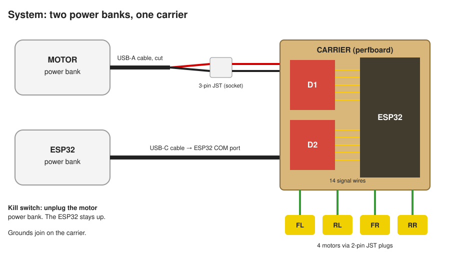

# Build guide: the M4 four-motor carrier

**Open [`index.html`](index.html) in a browser** (`xdg-open experiments/rovi-m4-four-motor-safety/build/index.html`). GitHub shows HTML files as source, so view it locally.

The page has 14 steps with instructions next to the matching picture, a checkbox for every action and every wire (saved in the browser, with a progress bar), warnings where they matter, and embedded crimping and perfboard videos.

## What's here

| File | What |
| --- | --- |
| [`index.html`](index.html) | The guide: parts, harnesses, crimping, power cable, carrier (dry fit, headers, capacitors, pigtails, 34 wires), checks, first power-up |
| [`wire-list.md`](wire-list.md) | The 34 carrier wires: colour, from, to, holes |
| [`img/`](img/) | All illustrations: [parts](img/parts.svg), [crimping](img/crimp.svg), [harness](img/harness.svg), [power cable](img/power-cable.svg), [carrier top](img/carrier-top.svg), [carrier bottom](img/carrier-bottom.svg), and per-step views |
| [`gen_build_guide.py`](gen_build_guide.py) | Generates all of the above from one layout table |

Everything is generated: edit `gen_build_guide.py`, then run `python3 build/gen_build_guide.py --check` from `experiments/rovi-m4-four-motor-safety/`. The check traces every wire on the carrier and compares the board's nets with the KiCad schematic ([`../wiring.kicad_sch`](../wiring.kicad_sch)): 25 nets, 34 wires, 0 problems. CI runs it and fails if the images, the wire list or the page are stale.
