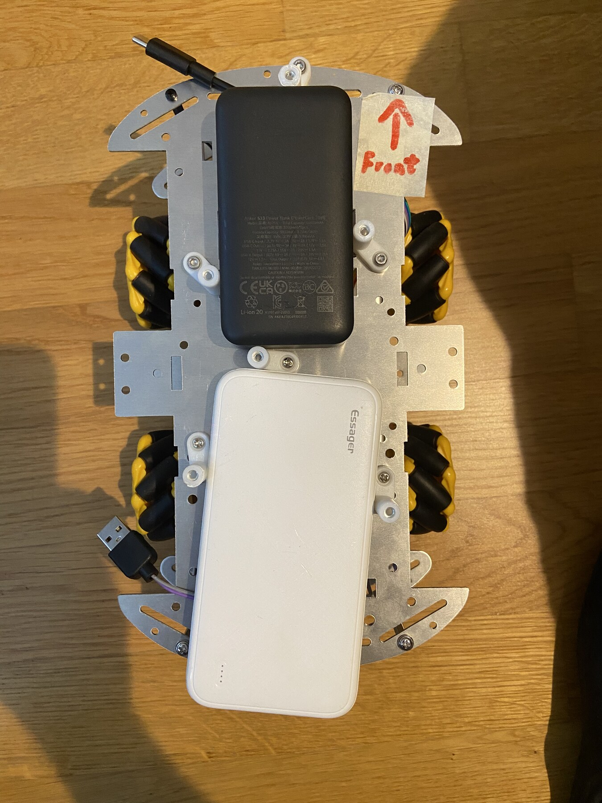

# Milestones

## M5: mecanum motion and feedback characterization

**Status:** planned (2026-10-17), next after M4. Bench procedure: [TESTPLAN.md](TESTPLAN.md).
**Setup:** M4's car and carrier with the wheels mounted, untethered: ESP32 and motors on their own power banks, controlled over BLE from the laptop. Measured with tape and phone video (no car log off the cable).

### Goal

Measure whether the received chassis and motor setup can provide useful open-loop mecanum teleoperation, map each driver channel to its wheel and direction, and establish whether the available hardware supports closed-loop wheel control.

### Risks covered

* Motor-to-wheel mapping, direction, mecanum roller orientation, and chassis assembly assumptions.
* Whether normalized PWM/duty commands are adequate or wheel speed feedback is required.
* Wheel-to-wheel calibration and variation under changing load/battery voltage.
* Whether encoders are present; do not assume them from the listing.

### Known from M4 (2026-10-17)

* Motor-to-channel mapping and direction confirmed; the motor layer runs 40-100 % duty (start threshold 35 % with the wheels off the ground).
* **No encoders:** the TT motors have two wires only. M5 is open loop; closed-loop speed would need added sensors (out of scope now).

### Test plan

1. Inspect the assembled chassis and motors. Record motor-to-wheel mapping, wheel diameter, roller orientation, total mass, and whether each motor has an encoder or other speed sensor.
2. With the car restrained and then on a clear low-friction test surface, command each wheel independently at safe low duty. Confirm direction, stop, and mapping.
3. Apply the proposed mecanum combinations for forward/reverse, lateral, and rotation. Record command-to-motion results, wheel slip, dead zones, and any chassis asymmetry.
4. Repeat at multiple battery states and representative payloads. Measure actual wheel speed or distance only with available instrumentation; otherwise record the open-loop observations and their limitations.
5. If encoders exist, compare measured wheel speed against commanded targets at several loads and decide whether closed-loop velocity is feasible. If none exist, document open-loop limitations and do not add sensing speculatively.

### Acceptance

Real hardware only; reuse the verified M4 setup and stay within its recorded electrical limits.

- [x] Motor, driver, wheel, and direction mapping is documented. *(M4 step 2; roller orientation checked in F1.)*
- [x] Four basic mecanum movement combinations and stop are demonstrated at safe speed. *(2026-10-17: forward/reverse, lateral, rotation and diagonal on the floor; clean physical stop explicitly confirmed in reverse. See results below.)*
- [ ] Repeatability and calibration variation are recorded across battery/load conditions.
- [ ] Encoder availability is confirmed; the open-loop versus closed-loop API decision has evidence and limitations. *(No encoders: confirmed in M4. The open-loop evidence comes from F3-F8.)*
- [ ] The API/spec can state units, bounds, stop behavior, update timing, and calibration needs without hidden assumptions.

### Results

#### Car measurements, 2026-10-17

Reported by Todor before the floor tests:

| Measurement | Value |
| --- | --- |
| Wheel outer diameter | 60 mm |
| Wheelbase (front to rear axle centres) | 115 mm |
| Track (left to right wheel centres) | 140 mm |
| Footprint, length × width | 255 × 170 mm |
| Mass with both power banks | 500 g |

Derived geometry: `wheels_radius = 0.030 m`; `center_projection_sum = (0.115 + 0.140) / 2 = 0.1275 m`.

At the time these dimensions were recorded, firmware geometry was still the placeholder. Subsequent stand measurements are recorded below; floor speed, drift and stopping distance remain unmeasured.

#### Top-view inspection, 2026-10-17

Source: Todor's `IMG_0522.HEIC`, supplied from `experiments/rovi-m4-four-motor-safety/`; the JPEG is resized and stripped of metadata. The [earlier unmarked photo](bench/2026-10-17-setup/top.jpg) is retained as setup evidence.

* All four mecanum wheels and both power banks are visible.
* The visible roller axes appear to form the expected X pattern ([WPILib reference](https://docs.wpilib.org/en/stable/docs/software/hardware-apis/motors/wpi-drive-classes.html)). This is photo evidence only; the F1 motion check remains pending.
* The FRONT arrow points toward the top of the image, beside the black power bank. Viewed this way: FL is upper-left, FR upper-right, RL (BL) lower-left and RR (BR) lower-right. Left and right are the car's own sides when facing forward.
* Wiring continuity, wheel clearance through a full turn and secure mounting cannot be established from this view.

Record firmware revision, floor surface, battery state, observations and evidence for each subsequent run.

#### F1 mounted-wheel direction checks, 2026-10-17

With the car on a stand, Todor confirmed forward, strafe-left and rotate-left wheel directions, including all four starting and stopping. See [run notes and BLE client output](bench/2026-10-17-f1/notes.md). One initial strafe run produced no movement; its cause remains unconfirmed. These stand tests do not establish actual chassis motion.

At `vx 0.1` for 5 s, Todor counted approximately 4.75 FL wheel rotations: **0.95 rev/s = 57 RPM = 5.97 rad/s**. With a 60 mm wheel diameter, nominal rim speed is approximately **0.179 m/s**, unloaded. This whole-run average is not floor speed; acceleration, stopping, slip and load are not resolved. Full-duty wheel-speed measurement and all floor tests remain pending.

At `vx 0.5` for 5 s, Todor counted approximately 6.5 FL rotations: **1.30 rev/s = 78 RPM = 8.17 rad/s**, nominal unloaded rim speed **0.245 m/s**. The same whole-run-average limitations apply; this is a second calibration point, not maximum wheel speed.

At `vx 1.0` for 5 s (a repeated run), Todor counted approximately 8.75 FL rotations: **1.75 rev/s = 105 RPM = 11.00 rad/s**, nominal unloaded rim speed **0.330 m/s**. This command used about 70% duty with the placeholder geometry and motor mapping then flashed; it was not a 100%-duty measurement. The three points describe one unloaded wheel, not calibrated chassis velocity or wheel-to-wheel variation.

#### Measured-geometry firmware prepared, 2026-10-17

Firmware source now uses radius 0.030 m and centre projection sum 0.1275 m. The speed-normalization parameter remains 40 rad/s as a placeholder; the 105 RPM observation at 70% duty is not a full-duty measurement. ESP32-S3 release build and clippy passed. **Flashed successfully; boot and BLE capabilities verified on the board** ([evidence](bench/2026-10-17-geometry/notes.md)). A separately authorized gentle forward run (`vx 0.1`, 5 s, approximately 45% duty) passed on the stand: Todor confirmed all four wheels started, turned forward and stopped cleanly. Floor tests remain pending.

The geometry change affects duty for the same command: forward `vx 0.1` is about 45%, `vx 0.5` about 65%, and `vx 1.0` about 90% (previously 43%, 55% and 70%). Repeat a gentle stand check after flashing; announce and agree each new motor run. Floor tests start with a short, low-command pulse, not a repeat of the five-second stand runs.

#### First floor movement, 2026-10-17

At `vx 0.05` for 0.5 s (approximately 42.5% duty), Todor confirmed the car moved. This is the lowest floor command tested, not an exact start threshold. The client reported a clean STOP; travel distance, drift, heading change and physical stopping behavior were not separately quantified or confirmed. See [F2 notes and client output](bench/2026-10-17-f2/notes.md). Loaded speed and repeatability remain unmeasured.

A subsequent identical pulse produced approximately **10 cm forward travel with no obvious drift**, reported by Todor. Displacement divided by command duration is approximately **0.20 m/s**, not steady-state speed: acceleration and coast after STOP were not separated. Repeatability, quantified drift, heading change and stopping distance remain pending. Commanded `vx` is not calibrated to actual chassis velocity.

Three distance observations with the same command were **10, 11 and 10 cm**, mean **10.3 cm**, range **1 cm**. This is a baseline at one command under the current conditions, not a test across battery/load states. Drift and physical stopping were not separately reported for the second or third runs. Mean displacement divided by command duration is approximately 0.207 m/s, including any coast after STOP; it is not steady-state speed.

#### First floor strafe, 2026-10-17

At `vx 0`, `vy 0.05` for 0.5 s, Todor reported **6.5 cm leftward travel**, with the **rear moving 1–2 mm farther left than the front**: a small heading change, not rearward translation. A second identical pulse gave **5.5 cm at the front, 6.0 cm at the rear** (rear travelled **5 mm farther left**). Reference points and angle were not measured, so the first run's single distance and the second run's two distances are not treated as equivalent measurements. Both clients reported STOP without an error; physical stopping was not separately confirmed. See [F4 notes and output](bench/2026-10-17-f4/notes.md). More repeat measurements and rightward motion remain pending; no compensation has been applied.

A third identical leftward pulse gave **7 cm at both front and rear**, with no front/rear difference detected at the reported precision. Rear swing was not consistent across all three runs; travel variation remains to be characterized under controlled conditions. No compensation applied. Rightward motion and quantified stopping remain pending.

For rightward strafe (`vy -0.05`, 0.5 s), a measured repeat gave **6.5 cm at the front and 7.5 cm at the rear** (rear travelled **1 cm farther right**). Todor observed apparent slip; its cause is unconfirmed. Rightward translation is demonstrated, but repeatability and quantified stopping remain pending. No firmware compensation applied; see [F4 notes](bench/2026-10-17-f4/notes.md).

A second measured rightward run gave **7 cm at the front, 7.5 cm at the rear** (rear travelled **5 mm farther right**). Rear swing recurred in both measured rightward runs, with different magnitude. Further characterization across commands and battery/load conditions remains open; no compensation applied.

#### First floor rotation, 2026-10-17

At `vx 0`, `wz 0.5` for 0.5 s, Todor reported approximately **40° left rotation**. The client reported STOP without an error; centre displacement and physical stopping were not separately reported. Angle divided by command duration is approximately **1.40 rad/s**, including any unseparated acceleration/coast; it is not steady-state turn rate. Commanded `wz` is not calibrated. See [F5 notes and output](bench/2026-10-17-f5/notes.md). Repeatability and clockwise rotation remain pending.

After two further identical leftward pulses, the first without a reported observation, Todor reported **40° left again with no noticeable centre shift** on the latest. Thus two reported angles agree at approximately 40°; measurement precision and battery/load effects remain uncharacterized. Clockwise rotation and quantified stopping remain pending.

At `wz -0.5` for 0.5 s, Todor reported **"ok, 40-45deg"**: approximately **40–45° right**, no problem reported, centre displacement not separately quantified. This is close to the 40° leftward observations at the opposite command, but is one rightward run. Rightward repeatability, calibrated turn rate and quantified stopping remain pending.

#### Reverse floor motion, 2026-10-17

Three pulses at `vx -0.05` for 0.5 s were sent; the first two were repeated without reported measurements. On the third, Todor confirmed **10 cm backward, straight, clean stop**. Reverse motion and a clean physical stop are demonstrated at this command; stopping distance and reverse repeatability are not quantified. The distance is close to the forward baseline (10, 11, 10 cm). See [F3 notes and output](bench/2026-10-17-f3/notes.md).

#### First floor diagonal, 2026-10-17

At `vx 0.05`, `vy 0.05` for 0.5 s, Todor measured **4.5 cm forward and 4.5 cm left**: approximately **45° left of forward**, total displacement **6.4 cm**. Heading change and physical stopping were not separately reported; diagonal direction does not prove unchanged heading. See [F6 notes and output](bench/2026-10-17-f6/notes.md). Forward-right motion and diagonal repeatability remain pending.

At `vx 0.05`, `vy -0.05` for 0.5 s, Todor reported the same component distances: **4.5 cm forward, 4.5 cm right**, approximately **45° right of forward**, total displacement **6.4 cm**. One measurement per diagonal direction; heading change and physical stopping were not separately reported, and repeatability remains uncharacterized.

#### Automatic lease stop on the floor, 2026-10-17

At `vx 0.05`, streamed for 0.3 s then stayed connected but silent for 2 s. The client observed **Stopped (`LeaseExpired`)**, and Todor confirmed forward motion followed by **a physical stop without further setpoints**. Travel distance was unknown. Total travel, distance after the last setpoint, coast distance and exact physical stop timing remain unmeasured. See [F7 notes and output](bench/2026-10-17-f7/notes.md). This is low-command functional evidence, not a high-speed stopping-distance result.
