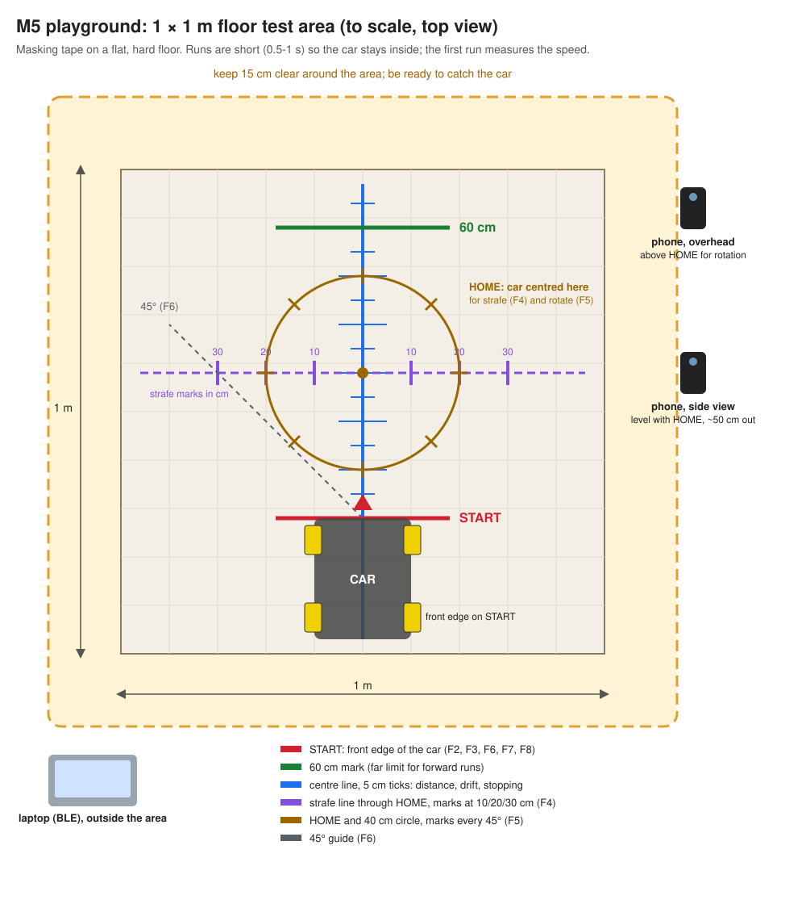

# M5 test plan: the car on the floor

The car drives **untethered**, controlled over BLE from the laptop (`sim/ble_client.py drive`, from `experiments/rovi-m8-setpoint-ros` in the repo `nix-shell`). There is no car log off the cable: the client reports the car's state and stop reason, and distances and speeds come from a **tape measure** and **phone video**. Each run is announced first and starts on Todor's "go".

## Setup

* **Wheels mounted in an X:** seen from above, the roller axes form an X across the car. The [setup photo with FRONT marked](MILESTONE.md#top-view-inspection-2026-10-17) appears to match; F1 checks motion. Keep this marker in place so observations use the same wheel positions as the firmware.
* **Firmware:** `main` (M4: duty 40-100 %, mapping and direction confirmed). Flash over USB, then unplug.
* **Power:** the ESP32 power bank on the board's USB-C port, the motor power bank on the carrier. **Wake the motor bank before each run** (it sleeps at 2.7 V when idle; M4).
* **Floor:** a clear, flat, hard area of **1 × 1 m** plus a 15 cm margin, the same surface for every run, marked with masking tape as below (drawing generated by [`img/gen_playground.py`](img/gen_playground.py)). Runs are short (0.5-1 s) so the car stays inside; the first forward run measures the speed and sets the length of the rest. Be ready to catch the car.

  

  * **START line** (red): forward, diagonal and stopping runs start with the car's front edge on it, pointing up the centre line.
  * **Centre line with 5 cm ticks** (blue) up to the **60 cm mark** (green): distance, drift and stopping distance on video.
  * **HOME** (brown dot) with a 40 cm circle, marks every 45°: centre the car here for strafe and rotate.
  * **Strafe line** (purple) through HOME, marks at 10, 20 and 30 cm each side.
  * **45° guide** (grey, dashed) from START for the diagonal.
  * **Phone:** side view level with HOME, about 50 cm out; overhead above HOME for rotation. **Laptop** outside the area.

### Measure on the car (once)

| # | Measure | How | Why |
| --- | --- | --- | --- |
| 1 | Wheel diameter (outer, across the rollers) | ruler or calliper, mm | `wheels_radius`: wheel rotation to distance |
| 2 | Wheelbase (front to rear axle, centre to centre) | ruler, mm | rotation: `center_projection_sum` = (wheelbase + track) / 2 |
| 3 | Track width (left to right wheel centres) | ruler, mm | as above |
| 4 | Footprint (length × width, wheels included) | ruler, mm | fits the area; turning clearance |
| 5 | Mass with both power banks | kitchen scale, g | the load behind the start duty |
| 6 | Roller pattern | photo from directly above | proves the X |
| 7 | Wheel speed at full duty, wheels in the air | tape flag on a wheel, 5 s of video, count turns | `max_wheel_speed`: makes speed commands real m/s |
| 8 | Power bank charge (LED bars), start and end of a session | look | explains speed drop (F8) |

Items 1-5 are recorded in [the milestone results](MILESTONE.md#results). Firmware with radius 0.030 m and centre projection sum 0.1275 m is flashed; boot and BLE capabilities are verified ([evidence](bench/2026-10-17-geometry/notes.md)). This changes duty at a given command (forward `vx 1.0` becomes about 90%, previously 70%); repeat a gentle stand check before floor driving. Item 7 and the floor runs are still needed for speed calibration. With open-loop motors and minimum-duty compensation, geometry alone does not make commanded m/s match actual speed.
* **Stopping the car:** Ctrl-C the client or walk out of range: the 1 s lease stops it. Unplugging the motor bank stops it at once. Start every run with the car pointing along the tape.

## Tests

The first low-command floor session is recorded in [MILESTONE.md](MILESTONE.md#results). Continue with [CALIBRATION.md](CALIBRATION.md): measured command response on parquet, then documented battery/load comparisons. Do not repeat the higher command values in this original matrix automatically; geometry changes duty, and command values are not calibrated speeds.

| # | Test | Command | Measure | Pass / output |
| --- | --- | --- | --- | --- |
| F1 | **Wheels-in-the-air check** with the wheels mounted (car on a box) | forward, strafe left, rotate left, 5 s each; then forward at full duty for item 7 | which way each wheel turns; roller X; wheel turns in 5 s | Same pattern as M4; rollers form an X; wheel speed |
| F2 | **Smallest command that moves the car** on the floor | `vx` 0.05, 0.1, 0.2, 0.3, 0.5 s each, from START | does it move | The lowest `vx` that moves it (start duty under load, O6) |
| F3 | **Straight line** | `vx` 0.5 for 0.5 s first (sets the run length), then `vx` 0.5 and 1.0, 3 times each, plus reverse, each ending before the 60 cm mark | distance travelled, sideways drift, end heading (video) | Speed in m/s per command; drift per metre |
| F4 | **Strafe** | `vy` 0.5 and 1.0 from HOME, short enough to stay within 30 cm, both directions | sideways distance, forward drift, rotation | Strafe works; speed and drift |
| F5 | **Rotate** | `wz` 1.5 and 3.0 on HOME, 1-2 s, both directions | angle turned (video from above), drift of the centre | Turn rate in rad/s |
| F6 | **Diagonal** | `vx = vy = 0.5` from START, about 0.5 s | direction of travel | Close to 45° |
| F7 | **Stopping** | `vx` 1.0 for 0.3 s, then STOP; then `vx` 0.5 for 0.3 s with `--quiet` (the lease adds about 1 s of travel: low speed only, ready to catch) | stopping distance (video against the tape) | Stopping distance for STOP and for the lease (adds about 1 s of travel) |
| F8 | **Battery drift** | repeat F3 at `vx` 1.0 at the end of the session | distance vs the first F3 | Speed change as the banks drain |

Every movement in F3-F7 is open loop: the car has no encoders (M4), so speed follows battery voltage and floor.

## What comes out

* **Measured speeds:** m/s and rad/s per command under the recorded conditions. Use these to calibrate `wheels_radius`, `max_wheel_speed` and the duty mapping; without feedback, actual speed will still vary with load, slip and supply voltage.
* **Open-loop decision (Q11):** with no encoders, is open-loop drift acceptable for teleoperation? This sets the M6 API's speed semantics.
* **Stopping distance** at top speed for STOP and for a lease expiry (O4/O5 on the floor).
* **The power decision:** how long the banks last driving, and whether the motor bank's sleep is acceptable or a battery pack is needed.

## Evidence

`bench/<date>-f<N>/`: `notes.md` (measurements, battery state, surface), the BLE client output, videos kept outside git (a few frames or a contact sheet in git).
